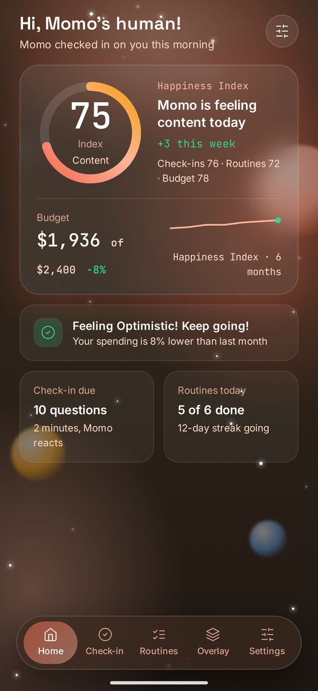
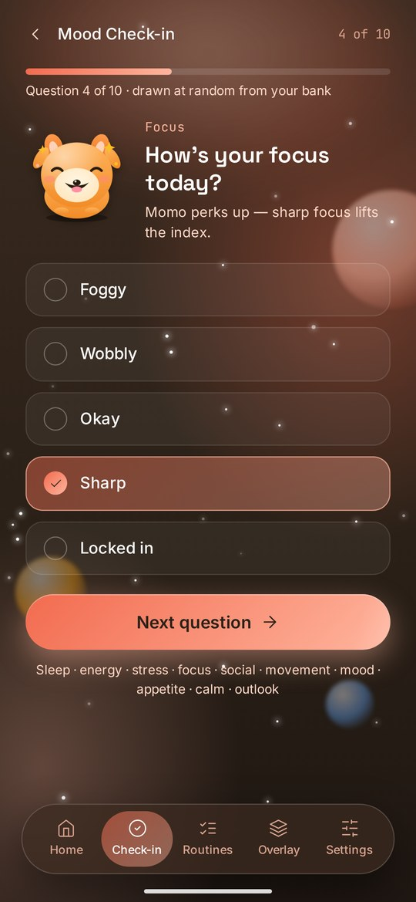
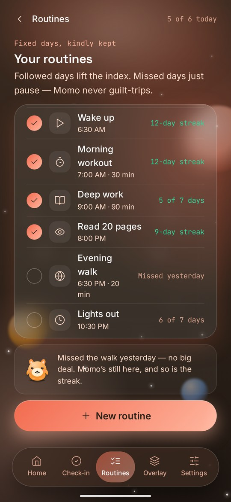
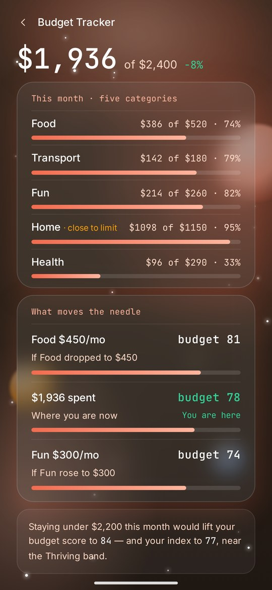
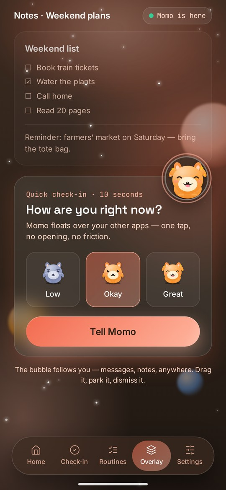

  

<h1 align="center">Momo</h1>

<strong>The pet that knows how you feel.</strong>

Momo is a happiness companion — a small corgi who lives on your phone and turns how you're doing into one honest number: the <strong>Happiness Index (0–100)</strong>, built from your mood, your routines, and your money. The formula is shown in the open, never hidden: mood × 40% + routines × 35% + budget × 25%.

<a href="https://mr-vishwet.github.io/burn-rate-pet/"><strong>Try the live demo →</strong></a>

---

- **Mood check-ins** — 10 quick questions drawn from sleep, energy, stress, focus, and more; about a minute, and Momo reacts to how you answer.
- **Daily routines** — the habits you set for yourself, kindly kept: streaks pause when you miss a day, they never punish.
- **Budget planner & tracker** — one monthly plan across categories, spent vs planned, with a what-if simulator to try changes before making them.
- **Happiness Index** — one number, three inputs, always inspectable; Momo's mood follows your band, from Thriving to Struggling.
- **The companion bubble** — Momo floats beside you in the app, so a 10-second check-in is always one tap away.
- **Guest-first, private by design** — no account needed; your data stays on your device.

  
  
  
  
  

