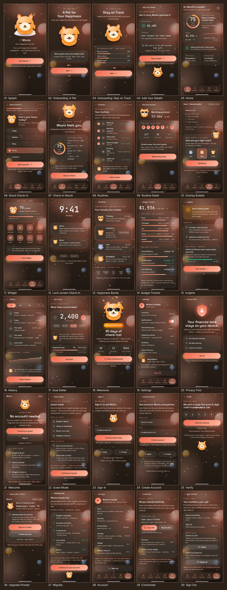
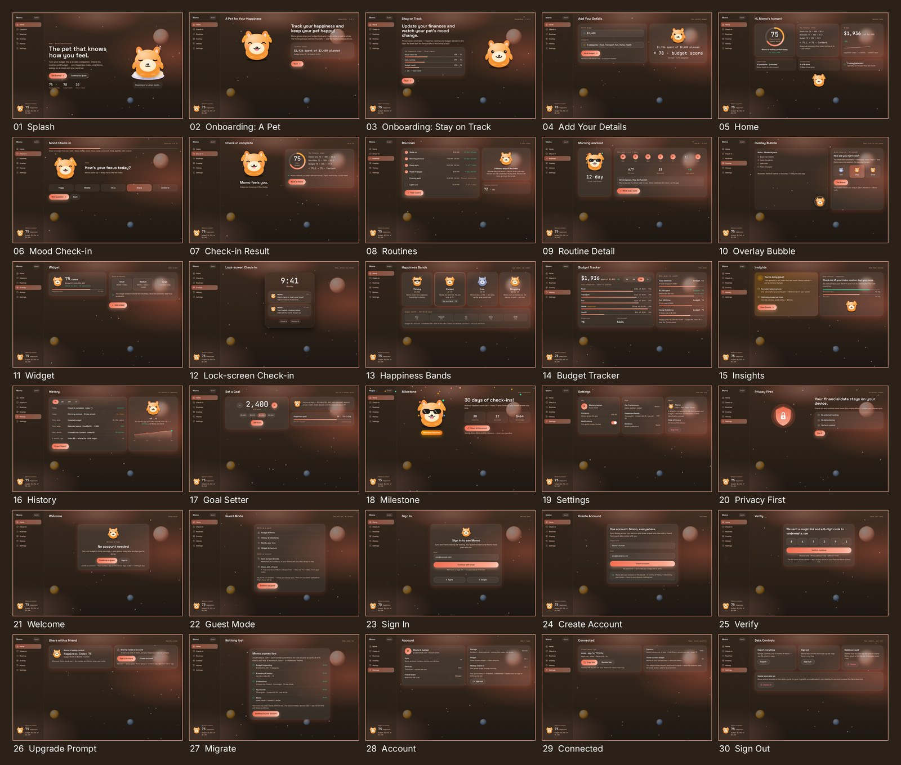

<p align="center">
  
</p>

<h1 align="center">Momo</h1>

<p align="center"><strong>The pet that knows how you feel.</strong></p>

<p align="center">A happiness companion that turns how you're doing — your mood, your routines, your money — into one honest number, and a small corgi who lives on your phone and notices, kindly.</p>

<p align="center"><a href="https://mr-vishwet.github.io/burn-rate-pet/"><strong>Try the live demo →</strong></a></p>

---

## The idea

Most wellness apps either nag you or reduce you to a streak. Momo starts from a different question: **how are you actually doing, all things considered?**

Your mood on a given day isn't one thing. It's how you slept, how stressed you are, whether you moved, whether you talked to anyone — and whether the small routines you set for yourself are holding, and whether money is quietly worrying you. Each of those is easy to feel and hard to see. Momo makes them visible, together, in one place.

The insight is that a single number only helps if you can see exactly what made it. So Momo's **Happiness Index (0–100)** is built from three inputs you can always inspect, with the formula shown in the open, never hidden:

```
Happiness Index = mood × 40% + routines × 35% + budget × 25%
```

And the number isn't even the point — the **band** is. Momo reacts to which band you're in: **Thriving** (80–100), **Content** (60–79), **Low** (40–59), or **Struggling** (below 40). The pet's mood follows your band, so the app feels like a companion noticing how you are, not a dashboard grading you.

The companion matters as much as the math. Momo is a small corgi who lives on your phone — a floating bubble you can tap any time, a home-screen widget, lock-screen check-ins — so the check-in finds you where you already are, instead of asking you to open yet another app and remember to be mindful.

And Momo never punishes. A missed routine pauses your streak; it doesn't reset it to zero. A low week is met with gentler prompts, not red warnings. The goal isn't a perfect score — it's noticing, early, when something is slipping, while it's still easy to nudge back.

## What it does

### Mood check-ins

Momo asks you **10 quick questions**, drawn at random from ten dimensions of how you're doing — sleep, energy, stress, focus, social connection, movement, mood, appetite, calm, and outlook. Each question has five simple answers, from rough to great. It takes about a minute.

Your mood score is the average of your recent check-ins, so one bad morning doesn't define your week — but a run of tired, stressed days shows up plainly. If you haven't checked in yet, Momo doesn't invent a number; it just asks for your first check-in.

Check-ins can happen right from the lock screen, or by tapping the floating bubble — no need to open the app and navigate anywhere.

### Daily routines

You create the routines that make your days work — a wake time, a workout, deep work, reading, an evening walk — and Momo tracks which ones you followed and which you missed. The routines score is your completion rate over the last 30 days.

Streaks **pause, they don't punish**: miss a day and the streak freezes; complete the routine the next day and it resumes from where it froze. Momo celebrates the return instead of mourning the gap. Each routine has its own detail view with its streak, its week at a glance, and its history — so you can see which habits are actually sticking and which ones keep quietly falling off.

### Budget planner & tracker

Money stress is happiness stress, so Momo includes a simple monthly budget: one plan across spending categories (food, transport, fun, home, health, and more), with spent-vs-planned shown per category. The budget score rewards staying comfortably within your plan — spending up to about a third of your plan costs nothing, and each category that goes over its plan costs points.

A "what if" simulator lets you try changes before making them — see how your budget score would move if food were a little lower, or fun a little higher — so the budget feels like a set of choices, not a lecture.

### The Happiness Index, in the open

Home shows the index as a ring, with the three inputs and their contributions right beside it. In the demo's example day, the numbers are mood 76, routines 72, and budget 78 — which combine to 75.1, shown as **75, Content** (30.4 from mood + 25.2 from routines + 19.5 from budget). Tapping into the formula shows the full breakdown, and a history view shows how the index has moved over time.

### Insights, milestones & goals

Momo reads your own numbers back to you as plain-language insights — which days your index runs higher, which routines correlate with better weeks, where your spending drifted. Milestones mark the moments worth celebrating (a 30-day check-in run, a streak record), and a goal setter lets you pick a target — a happiness goal, a budget goal, a routine goal — and watch progress toward it.

### The companion, everywhere

Momo the corgi lives beyond the app's screens:

- **Floating bubble** — a small Momo that floats over your phone; tap it for a one-tap mood check-in or a quick look at your index.
- **Home-screen widget** — your index and band at a glance, in small, medium, or large. It shows only the index and band — never amounts or answers — so it's safe on a shared screen.
- **Lock-screen check-ins** — Momo can ask how you're doing right from the lock screen, so a check-in takes seconds.

### Guest-first, private by design

No account is needed. The whole pet works as a guest — check-ins, routines, budget, the companion, all of it. Signing in unlocks only two things: keeping everything in sync across your devices, and sharing a read-only view with a friend (your index and band only — never amounts, never check-in answers).

Your data stays on your device. You can export everything, sign out, or delete it all, from one place in Settings.

## The interface

Momo has 30 screens, designed as one continuous flow — from the first splash and onboarding, through check-ins, routines, and budgeting, to history, goals, settings, and account.

**Mobile — all 30 screens**



**Web — all 30 screens**


